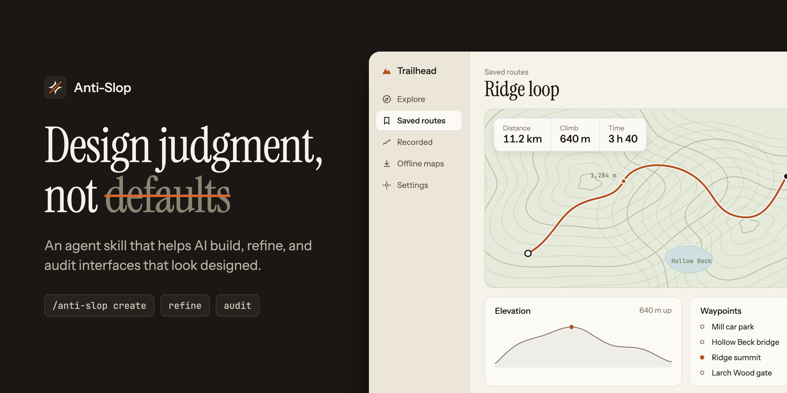

# Anti-Slop



**Give your AI better taste.**

The [project site](https://realmrhex.github.io/anti-slop/) has a playground: pick a product, theme, accent, and typeface, and it writes the prompt, CSS tokens, or a project note for you.

Anti-Slop is an Agent Skill that gives coding agents design judgment for user
interfaces. It helps an agent decide what a product's UI needs, recognise the
generic patterns that appear when nothing was decided, tell real problems from
matters of taste, and leave good work alone.

It is a set of Markdown instructions and references. There is no runtime, no
CLI, no browser automation, and no dependency. The agent uses its own tools to
read and edit your project; Anti-Slop supplies the reasoning.

```
/anti-slop create   build a new interface from the product outward
/anti-slop refine   make targeted improvements to an existing interface
/anti-slop audit    report problems without changing any code
```

## Philosophy

Anti-Slop does not have a style. It will not tell every agent to use the same
fonts, colours, spacing, or radii, because a trading terminal, a children's
reading app, and a literary magazine should not look alike.

- **Conviction over timidity.** Slop is the absence of a decision. A grey,
  centred, inoffensive page nobody chose is as generic as a purple gradient
  nobody chose. The skill pushes agents to find an idea and commit to it.
- **Intentionality over decoration.** Every visual element should communicate
  something: grouping, priority, state, identity, or feedback.
- **Clarity over complexity.** Remove competition before adding emphasis.
- **Coherence over tricks.** A consistent ordinary system beats isolated
  flourishes.
- **Context over universal taste.** Decisions come from the product, audience,
  and task.
- **Accessibility over surface beauty.** Accessibility requirements are
  constraints, not polish.
- **Existing systems over reinvention.** The project's tokens and components
  are followed, not replaced.
- **Preservation over rewrites.** What someone decided (function, real content,
  a real brand, a working system) is protected. Template defaults are not.
  When an interface is already good, doing nothing is the right result.

No pattern is banned. Gradients, cards, rounded corners, glass effects, dark
themes, and dense tables all have legitimate uses. What Anti-Slop targets is
mismatch, excess, and absence of purpose.

## Installation

Anti-Slop follows the [Agent Skills](https://agentskills.io/specification) format:
a directory named `anti-slop` with `SKILL.md` at its root.

### Manual (works anywhere skills are supported)

Clone into your agent's skills directory, keeping the directory name `anti-slop`:

```bash
git clone https://github.com/RealMrHex/anti-slop ~/.claude/skills/anti-slop
```

For a single project, clone into `.claude/skills/anti-slop` inside the repository
instead. Other agents read skills from their own directories (commonly
`.agents/skills/` in a project); check your agent's documentation and put the
`anti-slop` directory there.

### Skills CLI

The `skills` CLI installs skills from a
GitHub repository into the agents it detects:

```bash
npx skills add RealMrHex/anti-slop
```

Add `-g` for a global install and `-a <agent>` to target one agent (for example
`-a claude-code`). The command syntax is taken from the CLI's documentation;
installing this repository through it has not yet been tested by the
maintainers. If it does not pick up the skill, use the manual method.

### Supported agents

Any agent that implements the Agent Skills format. `SKILL.md` uses only fields
from the open specification, so it does not depend on one vendor's extensions.

| Agent | Status |
|---|---|
| Claude Code | Skill format and install paths verified against its documentation. `/anti-slop <workflow>` works as a slash command. |
| Other Agent Skills clients (Codex, Cursor, Gemini CLI, OpenCode, GitHub Copilot, and others) | Expected to work as a standard skill; not individually tested. Where slash commands are unavailable, ask in words ("use anti-slop to audit …"). |

## Usage

```text
/anti-slop create a settings page for notification preferences
/anti-slop refine src/components/PricingTable.tsx
/anti-slop audit app/dashboard
```

Or in plain language:

```text
Use anti-slop to review the checkout flow. Don't change anything yet.
This page looks AI-generated. Fix what's actually wrong with it.
```

### Workflows

**Create** starts from the product: who uses it, how often, for what. The agent
inspects existing conventions, writes a short direction brief, ranks the content
before styling it, builds every state, then reviews and corrects its own work.
In an existing product, it extends the system that is there.

**Refine** checks that the page works, decides how far to go (tune, elevate,
reinvent, or leave alone), then runs a third-party refine method included under its own licence (see
License): an audit against its list of signs, a direction taken from the
product, and passes over spacing, colour, icons, copy, type, layout, details,
visuals, and motion. Around that, Anti-Slop keeps behaviour, real content, and
accessibility intact, and reports what it changed and what it could not
verify.

**Audit** reports and edits nothing. Each finding has a location, category,
severity, classification, confidence, the principle involved with its evidence
class, an explanation, and a concrete suggestion. The report states whether it
is based on rendered output or source only, lists what could not be assessed,
and records what is working so a later refine does not undo it.

Bare `/anti-slop` on existing UI runs an audit.

Matching a reference design and extracting a design system from a codebase are
handled inside these workflows; see
[`references/design-systems.md`](references/design-systems.md).

## How it is organised

```
SKILL.md                    entry point: routing, principles, what to load when
workflows/                  create.md, refine.md, audit.md
references/
  core-contract.md          preservation, evidence classes, decision rule, honesty
  craft.md                  appeal, boldness, focal elements, finish checklist
  design-principles.md      hierarchy, grouping, attention, cognitive load
  typography.md  color.md  layout.md
  components.md  interaction.md  accessibility.md
  design-systems.md         existing conventions, reference matching, extraction
  striking-or-odd.md        research on why bold designs land or look wrong, as rules
  findings.md               research findings digest, with reach, and claims to avoid
  tells.md                  evidence-tagged checklist of reported AI-UI signs
  values.md                 concrete starting numbers, each with its basis
  slop-patterns.md          catalog of generic-UI patterns, with legitimate uses
  rubric.md                 review dimensions and finding classification
examples/                   worked outputs for each workflow
evals/                      fixtures, cases, checker, results
docs/research/              evidence ledger
```

The agent always reads `SKILL.md` and the core contract, then one workflow, then
only the references the task touches.

### Evidence classes

Every rule in the references is tagged so the agent knows how firmly to hold it:

| Tag | Meaning |
|---|---|
| `[standard]` | WCAG 2.2 requirement. A violation is a defect. |
| `[empirical]` | Supported by peer-reviewed research, within the study's scope. |
| `[convention]` | Established design-system, platform, or typographic practice. A strong default. |
| `[judgment]` | Anti-Slop's own heuristic or an aesthetic preference. Offered, never imposed. |
| `[reported]` | A sign people consistently name as reading "AI-made". Evidence they notice it, not that it harms. |

### The preservation contract

When refining, the agent preserves functionality and business logic, user
content, information architecture, accessibility behaviour, brand identity,
component conventions, the dependency set, and test hooks. It does not refactor
unrelated code or introduce values that conflict with the existing system. Every
change needs a one-line reason tied to a principle.

## Research basis

The references distil a commissioned research review covering HCI, visual
perception, Gestalt grouping, typography, colour science, layout, cognitive
psychology, interaction design, accessibility, design systems, and evaluation of
AI-generated interfaces. Principal sources include WCAG 2.2; Reinecke et al.
(CHI 2013) and Lindgaard et al. (2006) on first impressions; Tractinsky et al.
(2000) and Lavie & Tractinsky (2004) on aesthetics and perceived usability;
Ware and Treisman on visual attention; Norman on signifiers and feedback;
Bringhurst and Lupton on typography; Albers on colour; the Design2Code (NAACL
2025) and UI-Bench benchmarks; and the Apple, Material, Atlassian, and Carbon
design systems.

[`docs/research/evidence-ledger.md`](docs/research/evidence-ledger.md) lists
every source, its evidence class, which claims were re-verified against the
source during development and which were not, and claims that were softened or
left out.

## Limitations

- **The evidence is mixed, and recently negative.** All from one blind judge
  (the project owner), one run per side. An early version was preferred when
  building from short prompts (10 of 12). Later versions, on detailed prompts:
  on a small model the skill beat no skill; on a strong model it was ranked
  below no skill on both prompts tried. On refining, results ranged from
  6 of 8 on rough drafts to last place on two AI-looking example screens, where
  another skill did clearly better; on twenty further screens that skill was
  preferred 17 to 3. Refine now runs that skill's method, included under its licence
  (see License); in four blind tests of that version the owner preferred it on
  26 of 40 screens against the original (13 the other way, 1 the same), and 12
  of 20 on screens not seen before. A second, automated judge split one set 5
  to 5. Read that as level, perhaps slightly ahead: one small model, one run
  per side. An attempt to replace the method with one built only from
  published defaults and this project's own findings lost 9 to 1 and was
  withdrawn. Do not assume this skill
  improves the output of a capable model. [`evals/RESULTS.md`](evals/RESULTS.md) has every run.
- **It cannot see.** Anti-Slop adds no rendering or screenshot capability. If the
  host agent can view the rendered UI, the skill tells it to; otherwise the
  agent reasons from source and must say so. Visual balance, wrapping, contrast
  over images, and animation feel cannot be confirmed from code.
- **Not an accessibility audit.** It finds many common failures in source. It
  does not establish WCAG conformance, which needs testing with assistive
  technology.
- **The slop catalog is a set of hypotheses.** No study defines "AI UI slop".
  The catalog describes recurring patterns and when they do harm, and is
  explicit that none is inherently wrong.
- **Taste is not solved.** The skill separates defects from preferences and
  keeps preferences optional. It does not make an agent a designer.
- **It could become a style.** If agents using Anti-Slop converge on one
  restrained look across unrelated products, the skill has failed. The eval
  suite includes a test for this.

## Evaluating

```bash
python3 evals/check.py skill
```

checks that the repository is a well-formed skill (frontmatter, links, eval
fixtures). It needs only Python 3 and says nothing about design quality.

Behavioural evaluation compares the same agent with and without the skill on
the cases in [`evals/cases.json`](evals/cases.json): routing, audit not editing
files, preservation, finding real problems, avoiding false positives, no-op on
good interfaces, tolerance of different visual styles, and context-sensitive
creation. The protocol is in [`evals/README.md`](evals/README.md).

## Contributing

Contributions are welcome. Because this is a skill, changes are changes to an
agent's behaviour:

- **Start from a failure.** Add a fixture and case to `evals/` that shows the
  agent doing the wrong thing, then change the skill. Pair each new "should be
  caught" with a look-alike that should be left alone.
- **Tag evidence honestly.** New rules need an evidence class. If a claim is
  empirical, cite it and note its scope; update the evidence ledger, including
  whether you checked the source.
- **Include exceptions.** A rule without "when not to apply it" will be
  over-applied. No absolute bans on visual patterns.
- **Keep it small.** `SKILL.md` stays concise; detail goes in the one reference
  where it belongs; nothing is stated twice.
- **No tooling creep.** No browser automation, screenshot pipelines, servers,
  external APIs, or runtime dependencies. Dependency-free scripts that validate
  the skill's own files are acceptable.
- **No unsupported claims.** Do not add benchmark numbers that were not
  measured, or quality claims the evals do not support.
- Run `python3 evals/check.py skill` before opening a pull request.

## License

[MIT](LICENSE), except `references/unslop/` (a copy of *unslop* by Damir
Sokolovsky, [heydamir/unslop](https://github.com/heydamir/unslop), with the
changes noted in its `method.md`) and `references/details.md` (adapted from
it), which are [CC BY 4.0](https://creativecommons.org/licenses/by/4.0/).
